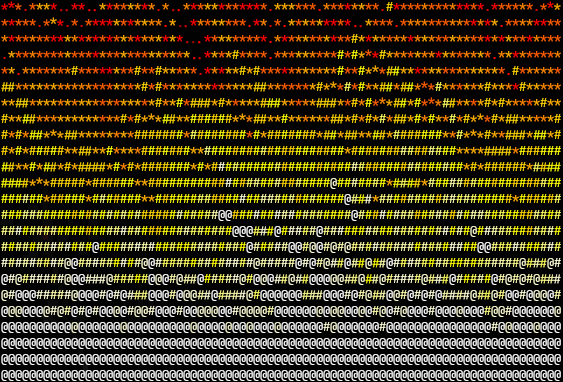

<div align="center">
  
</div>

# COBOL Doom Fire

Doom fire algorithm implemented in COBOL, rendered in the terminal.

## Requirements

- GnuCOBOL (`cobc`)
  `sudo apt install gnucobol build-essential libgmp-dev libdb-dev libncurses-dev libxml2-dev libjson-c-dev`
- A terminal that supports ANSI escape sequences (Tested on kitty)

## Build & Run

```sh
cobc -x -free doomfire.cob
./doomfire

# Press Ctrl-C to stop the fire / exit.
```

Note: If binutils clashed with package manager (like Homebrew binutils), run by using explicit path

```sh
PATH=/usr/bin:/bin cobc -x -free doomfire.cob
./doomfire

# Press Ctrl-C to stop the fire / exit.
```

## Configuration

The speed can be adjusted by changing `FRAME-DELAY` in the `WORKING-STORAGE SECTION`:

- Lower number = faster fire (e.g., `300000`)
- Higher number = slower fire (e.g., `3000000`)

This implementation uses a 1D array to represent the 2D grid, with manual index calculation `(Y - 1) * W + X`.
Randomness is provided by the built-in `FUNCTION RANDOM`, seeded by `ACCEPT RAND-SEED FROM TIME`.

# Credit
Learnt basics of COBOL from [writ3it's cobol-examples](https://github.com/writ3it/cobol-examples).
